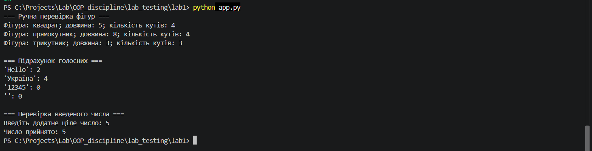
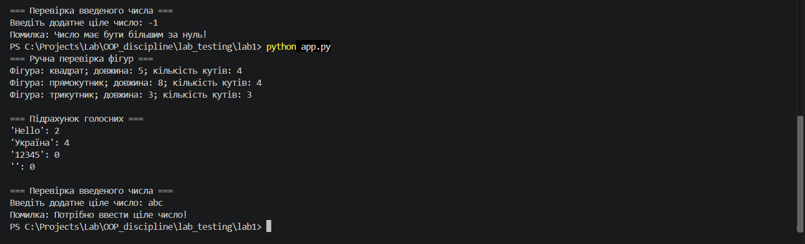
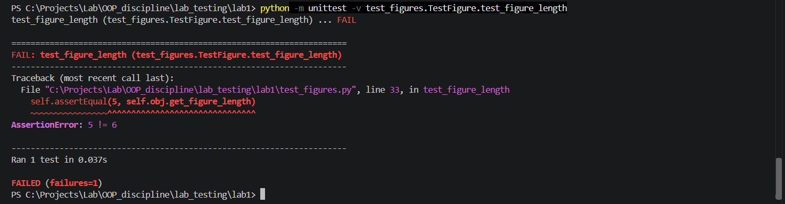
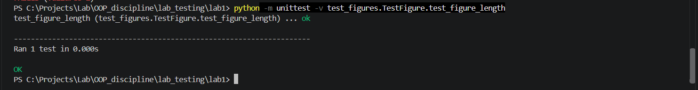
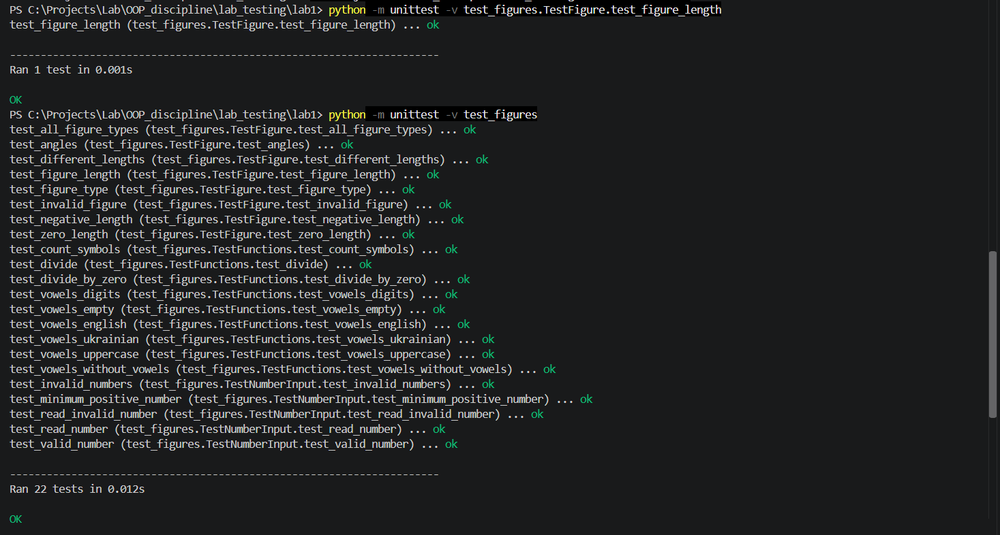

# Звіт до роботи

## Тема: Загальне тестування та юніт-тести

### Мета роботи:
Навчитися перевіряти правильність роботи програми, створювати юніт-тести за допомогою модуля unittest, перевіряти винятки та використовувати subTest і unittest.mock.

---

### Виконання роботи

1. **Створення програми та перевірка даних**

   За основу взято наданий клас `Figure`. У конструкторі реалізовано перевірку додатної довжини та допустимого типу фігури через `assert`. Якщо умова хибна, виникає `AssertionError`.

   Створено функцію `validate_number()`, яка перевіряє, чи введено додатне ціле число. Для неправильних даних використано `raise ValueError`. Функція `read_number()` отримує значення через `input()` та передає його на перевірку.

   Основний код програми: [app.py](./app.py).

2. **Ручна перевірка програми**

   Створено об’єкти квадрата, прямокутника та трикутника. Перевірено властивості `get_figure_type`, `get_figure_length` і доданий метод `get_angles()`, який повертає кількість кутів.

   Отримано такі результати:

   ```text
   Фігура: квадрат; довжина: 5; кількість кутів: 4
   Фігура: прямокутник; довжина: 8; кількість кутів: 4
   Фігура: трикутник; довжина: 3; кількість кутів: 3
   ```

   Під час введення числа `5` програма вивела повідомлення `Число прийнято: 5`.

   ![Ручна перевірка програми та правильне введення]

   *Рисунок 1 — Ручна перевірка програми та правильне введення.*

3. **Перевірка неправильного введення**

   Виконано перевірку від’ємного числа та текстового значення.

   ```text
   Введіть додатне ціле число: -1
   Помилка: Число має бути більшим за нуль!
   ```

   ```text
   Введіть додатне ціле число: abc
   Помилка: Потрібно ввести ціле число!
   ```

   Програма обробила винятки та вивела зрозумілі повідомлення.

   ![Обробка неправильного введення]

   *Рисунок 2 — Обробка неправильного введення: від’ємного числа та тексту.*

4. **Тестування функцій**

   Створено функцію `count_symbols()` для визначення кількості символів і функцію `count_vowels()` для підрахунку українських та англійських голосних незалежно від регістру.

   ```python
   def count_vowels(text: str) -> int:
       vowels = "аеєиіїоуюяaeiou"
       return sum(letter in vowels for letter in text.lower())
   ```

   Для підрахунку голосних додано тести звичайного тексту, великих літер, рядка без голосних, порожнього рядка, цифр та українського тексту.

   Приклади результатів:

   ```text
   'Hello': 2
   'Україна': 4
   '12345': 0
   '': 0
   ```

   Для функції `divide()` перевірено звичайне ділення та виникнення `ZeroDivisionError` під час ділення на нуль.

5. **Тестування класу Figure**

   Створено клас `TestFigure`, який наслідує `unittest.TestCase`. Перевірено тип фігури, довжину та кількість кутів. Додано перевірки нульової довжини, від’ємної довжини та невідомого типу фігури.

   Для порівняння значень використано `assertEqual`, а для перевірки винятків — `assertRaises`.

   ```python
   def test_negative_length(self):
       with self.assertRaises(AssertionError):
           Figure("квадрат", -5)
   ```

   Код усіх тестів: [test_figures.py](./test_figures.py).

6. **Виявлення та виправлення помилки**

   У наданих вихідних файлах властивість `get_figure_length` уже була реалізована правильно, а тест довжини був активним. Тому для демонстрації виявлення помилки тимчасово змінено реалізацію:

   ```python
   @property
   def get_figure_length(self) -> int:
       return self.length + 1
   ```

   Запущено тест:

   ```powershell
   python -m unittest -v test_figures.TestFigure.test_figure_length
   ```

   Тест очікував значення `5`, але отримав `6`:

   ```text
   AssertionError: 5 != 6
   FAILED (failures=1)
   ```

   ![Виявлення помилки тестом]

   *Рисунок 3 — Виявлення тестом тимчасово внесеної помилки у властивості get_figure_length.*

   Після цього повернуто правильну реалізацію:

   ```python
   @property
   def get_figure_length(self) -> int:
       return self.length
   ```

   Повторний запуск цього самого тесту завершився успішно.

   ![Успішний тест після виправлення]

   *Рисунок 4 — Успішне виконання тесту після виправлення помилки.*

7. **Життєвий цикл тесту**

   У класі `TestFigure` використано такі методи:

   - `setUpClass()` — один раз перед тестами класу готує список типів фігур;
   - `setUp()` — перед кожним тестом створює новий об’єкт квадрата;
   - `tearDown()` — після кожного тесту прибирає посилання на створений об’єкт;
   - `tearDownClass()` — після тестів класу очищає підготовлений список.

   Завершальні методи в цій роботі демонструють життєвий цикл тесту. Зовнішні ресурси не використовуються.

   Назви тестових методів починаються з `test_`. Кожен тест отримує окремий об’єкт, тому перевірки не залежать від змін об’єкта в інших тестах.

8. **Використання subTest**

   За допомогою `subTest` перевірено всі типи фігур у межах одного тестового методу.

   ```python
   def test_all_figure_types(self):
       for figure_type in self.figure_types:
           with self.subTest(figure_type=figure_type):
               figure = Figure(figure_type, 5)
               self.assertEqual(
                   figure_type,
                   figure.get_figure_type,
               )
   ```

   Якщо перевірка одного набору даних не пройде, результат покаже відповідний тип фігури. Наступні набори також будуть перевірені.

9. **Використання unittest.mock**

   Для автоматизованої перевірки функції з `input()` використано `patch`.

   ```python
   @patch("builtins.input", return_value="5")
   def test_read_number(self, mock_input):
       self.assertEqual(5, read_number())
       mock_input.assert_called_once_with(
           "Введіть додатне ціле число: "
       )
   ```

   Під час тестування `input()` повертає `"5"` без ручного введення. Перевірка числа виконується справжньою функцією `validate_number()`. Окремий тест перевіряє неправильне введення `"abc"`.

10. **Команди запуску та загальний результат**

    Команда запуску програми:

    ```powershell
    python app.py
    ```

    Запустити всі тести можна одним із двох способів:

    ```powershell
    python test_figures.py
    ```

    ```powershell
    python -m unittest -v test_figures
    ```

    Під час загального запуску виконано 22 тести за 0.012 секунди. Усі тести пройшли успішно:

    ```text
    Ran 22 tests in 0.012s

    OK
    ```

    ![Результат виконання всіх тестів]

    *Рисунок 5 — Результат виконання всіх юніт-тестів.*

---

### Висновок

Під час роботи доповнено клас Figure, створено функції перевірки введення та підрахунку голосних, виконано ручне тестування й підготовлено 22 автоматизовані тести. Мети роботи досягнуто.

Отримано практичні знання з використання unittest, перевірки винятків, життєвого циклу тестів, subTest і unittest.mock. Виконано всі наведені завдання та опрацьовано питання, передбачені умовою роботи.

Під час виконання виникли труднощі з вибором робочої папки та збереженням змін у потрібному файлі. Їх усунуто перевіркою шляху до модуля та збереженням файлів перед запуском.

Формат здачі у Markdown зручний, оскільки дозволяє поєднувати пояснення, код, посилання на файли та скриншоти. Для покращення завдання доцільно уточнити, що метод get_angles має повертати кількість кутів, а також оновити пункт про помилку довжини відповідно до наданих вихідних файлів.

---