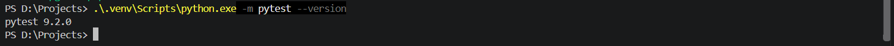
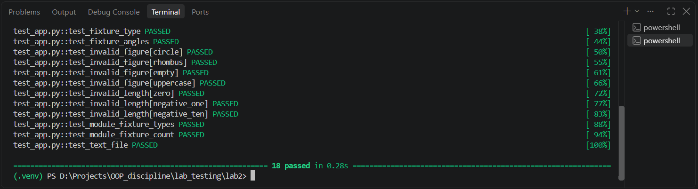
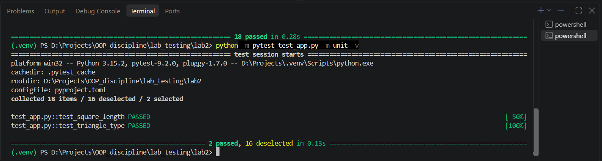
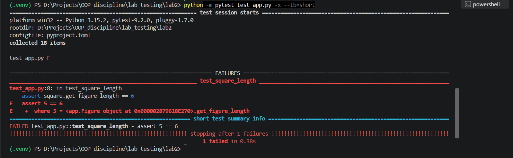
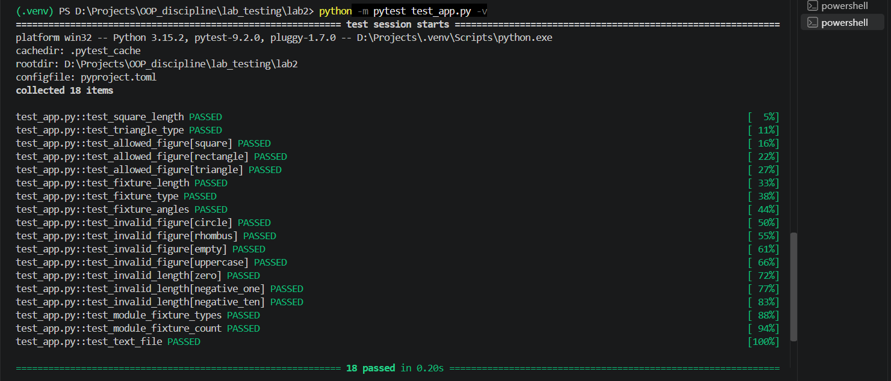

# Звіт до роботи

## Тема: Тестування з бібліотекою pytest

### Мета роботи:
Навчитися створювати та запускати тести за допомогою pytest, перевіряти винятки, використовувати параметризацію, fixtures та маркери.

---

### Виконання роботи

1. **Підготовка середовища**

   Для роботи використано віртуальне середовище Python та встановлено бібліотеку pytest.

   Команда встановлення:

   ```powershell
   python -m pip install pytest
   ```

   Перевірка версії:

   ```powershell
   python -m pytest --version
   ```

   Отримано версію `pytest 9.2.0`.

   ![Версія pytest]

   *Рисунок 1 — Перевірка встановленої версії pytest.*

2. **Організація файлів**

   Створено такі файли:

   - [app.py](./app.py) — клас Figure;
   - [test_app.py](./test_app.py) — функції тестування;
   - [conftest.py](./conftest.py) — спільні fixtures;
   - [pyproject.toml](./pyproject.toml) — налаштування pytest і реєстрація маркерів.

   Клас Figure підтримує квадрат, прямокутник та трикутник. Перевіряється додатна довжина та допустимий тип фігури.

3. **Створення простих тестів**

   Тести написано як звичайні функції, назви яких починаються з `test_`. Для порівняння результатів використано `assert`.

   ```python
   @pytest.mark.unit
   def test_triangle_type():
       triangle = Figure("трикутник", 4)
       assert triangle.type == "трикутник"
   ```

   Для запуску всіх тестів виконано:

   ```powershell
   python -m pytest test_app.py -v
   ```

   Параметр `-v` показує назву та результат кожної перевірки.

   Під час першого запуску всі 18 перевірок завершилися успішно:

   ```text
   18 passed in 0.28s
   ```

   ![Перший запуск усіх тестів]

   *Рисунок 2 — Результат виконання всіх тестів pytest.*

4. **Параметризація тестів**

   Додано параметризований тест для всіх дозволених типів фігур:

   ```python
   @pytest.mark.parametrize(
       "figure_type",
       Figure.FIGURES,
       ids=["square", "rectangle", "triangle"],
   )
   def test_allowed_figure(figure_type):
       figure = Figure(figure_type, 1)
       assert figure.get_figure_type == figure_type
   ```

   Pytest запускає цю функцію окремо для кожного значення. Це дозволяє перевірити кілька наборів даних без дублювання коду.

5. **Перевірка неправильних даних**

   За допомогою `pytest.raises` перевірено виникнення `AssertionError`.

   Для неправильних типів використано значення `"коло"`, `"ромб"`, порожній рядок і `"КВАДРАТ"`.

   Для неправильної довжини використано `0`, `-1` та `-10`.

   ```python
   @pytest.mark.parametrize("length", [0, -1, -10])
   def test_invalid_length(length):
       with pytest.raises(
           AssertionError,
           match="Довжина має бути більшою за 0!",
       ):
           Figure("квадрат", length)
   ```

   Тест проходить, якщо програма викликає очікуваний виняток із відповідним повідомленням.

6. **Використання fixtures**

   У файлі conftest.py створено fixture, яка повертає квадрат із довжиною 5:

   ```python
   @pytest.fixture
   def square():
       return Figure("квадрат", 5)
   ```

   Тест отримує об’єкт через аргумент із назвою fixture:

   ```python
   @pytest.mark.unit
   def test_square_length(square):
       assert square.get_figure_length == 5
   ```

   За замовчуванням fixture має область дії `function`: для кожного тесту створюється окремий об’єкт.

   Також створено залежні fixtures:

   ```python
   @pytest.fixture
   def length():
       return 10


   @pytest.fixture
   def figure_ten(length):
       return Figure("квадрат", length)
   ```

   Для об’єкта figure_ten окремо перевірено довжину 10, тип «квадрат» і кількість кутів 4.

7. **Fixture з областю дії module**

   Створено fixture:

   ```python
   @pytest.fixture(scope="module")
   def allowed_figures():
       return tuple(Figure.FIGURES)
   ```

   Її використано у двох тестах: для перевірки складу дозволених фігур та їх кількості.

   Завдяки `scope="module"` результат створюється один раз і повторно використовується в межах тестового модуля. Використано кортеж, який не можна змінювати, щоб уникнути випадкової зміни спільних даних.

8. **Тимчасовий файл та очищення після тесту**

   Створено fixture з використанням вбудованої fixture `tmp_path`:

   ```python
   @pytest.fixture
   def text_file(tmp_path):
       path = tmp_path / "result.txt"
       path.write_text("готово", encoding="utf-8")

       yield path

       path.unlink()
   ```

   Перед тестом створюється файл із текстом «готово». Тест перевіряє його вміст. Після тесту виконується код після `yield`, який видаляє файл.

9. **Використання маркерів**

   До двох тестів додано маркер `unit`. Маркери зареєстровано у pyproject.toml:

   ```toml
   [tool.pytest.ini_options]
   testpaths = ["."]
   python_files = ["test_*.py"]
   markers = [
       "unit: швидкі юніт-тести",
       "slow: повільні тести",
   ]
   ```

   Для запуску лише тестів із маркером unit виконано:

   ```powershell
   python -m pytest test_app.py -m unit -v
   ```

   Результат:

   ```text
   2 passed, 16 deselected in 0.13s
   ```

   Два тести виконано успішно, а 16 інших відфільтровано.

   ![Запуск тестів із маркером unit]

   *Рисунок 3 — Запуск тестів із маркером unit.*

10. **Навмисна помилка та зупинка тестування**

    У першому тесті тимчасово змінено очікувану довжину з 5 на 6:

    ```python
    @pytest.mark.unit
    def test_square_length(square):
        assert square.get_figure_length == 6
    ```

    Виконано команду:

    ```powershell
    python -m pytest test_app.py -x --tb=short
    ```

    Параметр `-x` зупиняє запуск після першої невдачі. Параметр `--tb=short` скорочує опис місця виникнення помилки.

    Отримано:

    ```text
    FAILED test_app.py::test_square_length - assert 5 == 6
    stopping after 1 failures
    1 failed in 0.38s
    ```

    Pytest знайшов 18 перевірок, але виконав лише першу, яка завершилася невдало. Решта 17 не запускалися.

    ![Зупинка після першої помилки]

    *Рисунок 4 — Зупинка тестування після першої помилки.*

11. **Виправлення тесту**

    Повернуто правильне очікуване значення:

    ```python
    @pytest.mark.unit
    def test_square_length(square):
        assert square.get_figure_length == 5
    ```

    Повторно виконано:

    ```powershell
    python -m pytest test_app.py -v
    ```

    Усі перевірки пройшли успішно:

    ```text
    18 passed in 0.20s
    ```

    ![Успішний запуск після виправлення]

    *Рисунок 5 — Успішне виконання всіх тестів після виправлення.*

12. **Порівняння unittest та pytest**

    | Ознака | unittest.TestCase | Функції pytest |
    |---|---|---|
    | Організація | Методи класу, що наслідує TestCase | Звичайні функції test_ |
    | Порівняння | self.assertEqual(a, b) | assert a == b |
    | Перевірка винятків | self.assertRaises(...) | pytest.raises(...) |
    | Підготовка даних | setUp() та setUpClass() | Fixtures |
    | Кілька наборів даних | Наприклад, цикл із subTest | parametrize |
    | Встановлення | Входить до стандартної бібліотеки | Встановлюється окремо |

    У pytest можна писати коротші тести без створення класу. Параметризація дозволяє окремо запускати кожен набір даних, а fixtures — повторно використовувати підготовку об’єктів і ресурсів.

---

### Висновок

Під час роботи встановлено pytest, створено тести для класу Figure та виконано 18 перевірок. Мети роботи досягнуто: опрацьовано звичайні assert, перевірку винятків, параметризацію, fixtures і маркери.

Навчились створювати залежні fixtures, використовувати scope="module", працювати з тимчасовими файлами та виконувати очищення після тесту. Також порівняно написання тестів у unittest і pytest.

Виконано всі завдання, позначені зірочками, та опрацьовано передбачені ними питання. Навмисно внесена помилка підтвердила роботу параметра -x. Після виправлення всі тести пройшли успішно.

Під час підготовки потрібно було врахувати розташування віртуального середовища та запускати тести з папки lab2.

Формат звіту Markdown зручний для поєднання пояснень, коду та скриншотів. Для покращення завдання можна додати готовий приклад структури папок і команд для Windows PowerShell.

---