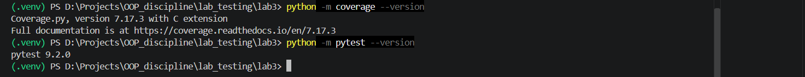
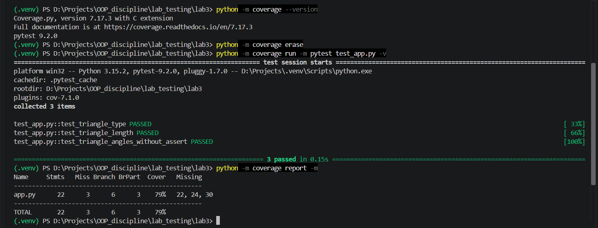
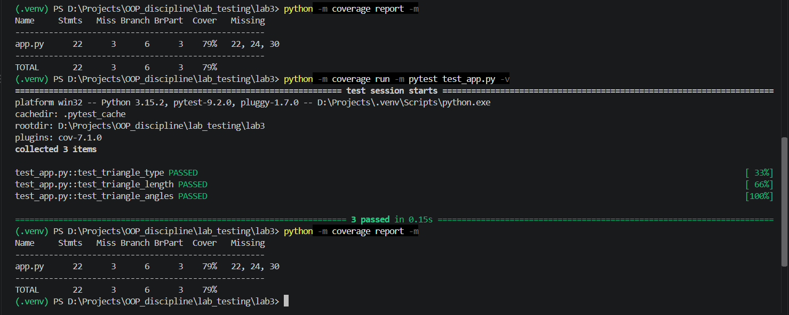
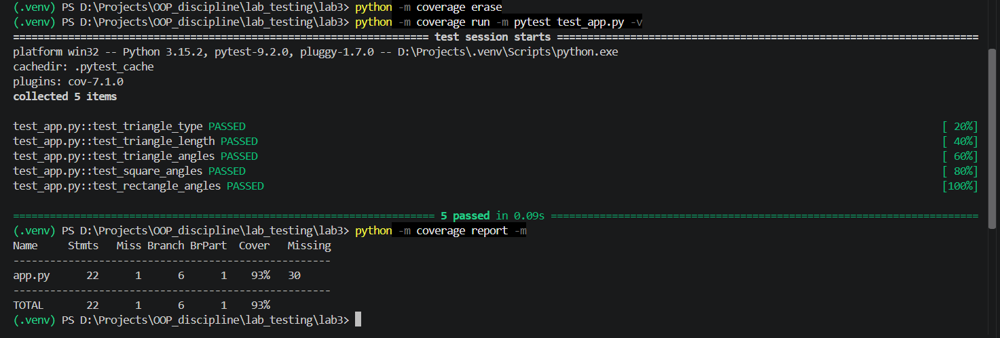
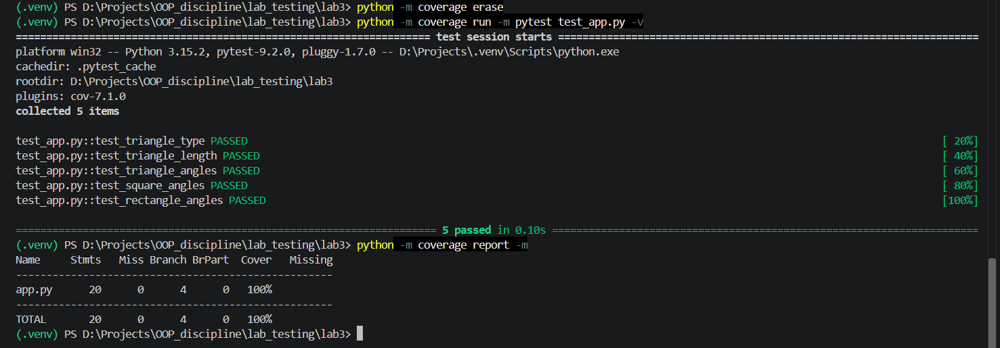
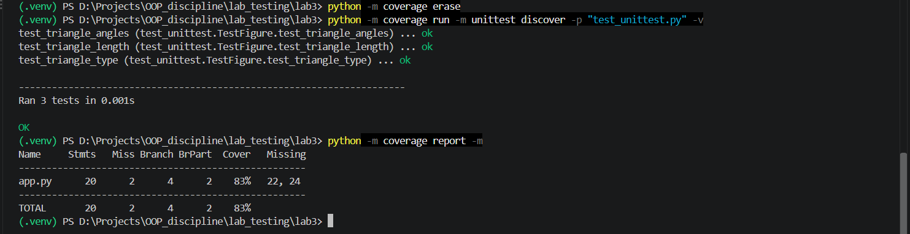
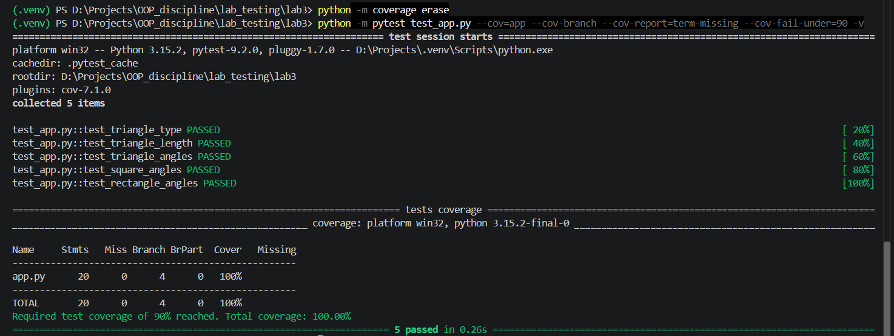
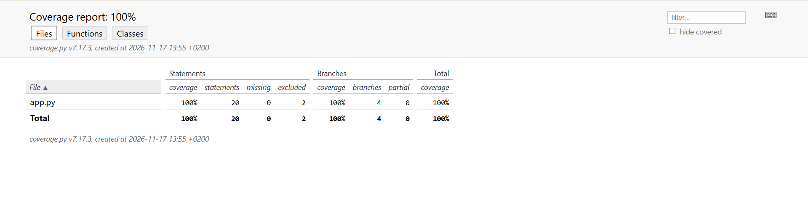
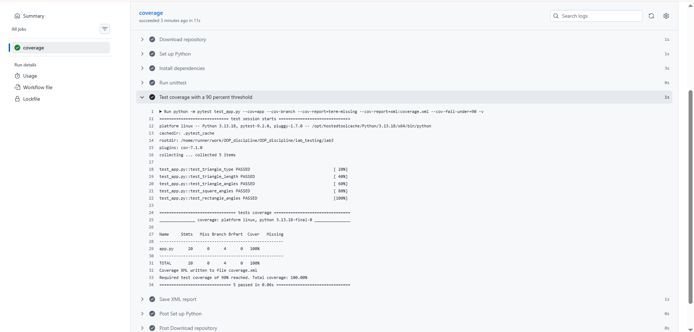

# Звіт до роботи

## Тема: Покриття коду

### Мета роботи:
Навчитися вимірювати покриття коду тестами за допомогою coverage.py та pytest-cov, аналізувати непокриті рядки й розгалуження, створювати HTML/XML-звіти та автоматизувати перевірку мінімального порогу покриття в GitHub Actions.

---

### Виконання роботи

1. **Підготовка середовища**

   Використано віртуальне середовище Python. Встановлено потрібні бібліотеки:

   ```powershell
   python -m pip install coverage pytest pytest-cov
   ```

   Перевірено версії:

   ```powershell
   python -m coverage --version
   python -m pytest --version
   ```

   Встановлено Coverage.py 7.17.3 та pytest 9.2.0.

   ![Версії інструментів]

   *Рисунок 1 — Перевірка встановлених інструментів тестування та покриття коду.*

2. **Підготовка програми й тестів**

   Створено клас Figure, який підтримує квадрат, прямокутник і трикутник. Властивість get_angles повертає кількість кутів та містить окремі гілки для різних фігур.

   Підготовлено два незалежні набори тестів: функції pytest та клас unittest.TestCase.

   Файли роботи:

   - [app.py](./app.py) — програма;
   - [test_app.py](./test_app.py) — тести pytest;
   - [test_unittest.py](./test_unittest.py) — тести unittest;
   - [.coveragerc](./.coveragerc) — налаштування покриття;
   - [.gitignore](./.gitignore) — виключення службових файлів;
   - [coverage.yml](../../.github/workflows/coverage.yml) — перевірка в GitHub Actions.

3. **Налаштування вимірювання**

   У файлі .coveragerc задано:

   ```ini
   [run]
   source = app
   branch = true

   [report]
   show_missing = true
   omit =
       test_*.py
       */.venv/*

   exclude_lines =
       pragma: no cover
   ```

   Параметр source обмежує вимірювання модулем app.py. Параметр branch вмикає вимірювання розгалужень. У звітах відображався лише app.py, тестові файли не включалися.

   Команда coverage run запускає тести та записує дані у файл .coverage. Команда coverage report читає ці дані й формує таблицю. Перед окремими вимірюваннями виконано coverage erase, щоб явно очистити попередні результати.

4. **Початкове покриття pytest**

   Спочатку перевірено лише тип, довжину та виклик get_angles для трикутника.

   Виконано команди:

   ```powershell
   python -m coverage erase
   python -m coverage run -m pytest test_app.py -v
   python -m coverage report -m
   ```

   Усі 3 тести пройшли. Отримано результат:

   ```text
   Name      Stmts   Miss Branch BrPart  Cover   Missing
   app.py       22      3      6      3    79%   22, 24, 30
   ```

   Непокриті рядки:

   - 22 — повернення кількості кутів квадрата;
   - 24 — повернення кількості кутів прямокутника;
   - 30 — повідомлення при прямому запуску скрипта.

   ![Початкове покриття]

   *Рисунок 2 — Початкове покриття коду тестами pytest.*

5. **Виконання коду без перевірки результату**

   Початковий тест лише викликав властивість:

   ```python
   def test_triangle_angles_without_assert():
       triangle = Figure("трикутник", 4)
       triangle.get_angles
   ```

   Після цього додано перевірку очікуваного значення:

   ```python
   def test_triangle_angles():
       triangle = Figure("трикутник", 4)
       assert triangle.get_angles == 3
   ```

   Повторний запуск показав ті самі 79% покриття.

   Отже, додавання assert не змінило перелік виконаних рядків програми, але зробило тест змістовнішим: тепер неправильна кількість кутів спричинить невдалий результат.

   ![Покриття після assert]

   *Рисунок 3 — Покриття після додавання перевірки результату через assert.*

6. **Додавання тестів усіх типів фігур**

   Додано перевірки квадрата та прямокутника:

   ```python
   def test_square_angles():
       square = Figure("квадрат", 5)
       assert square.get_angles == 4


   def test_rectangle_angles():
       rectangle = Figure("прямокутник", 8)
       assert rectangle.get_angles == 4
   ```

   Повторно виконано окреме вимірювання pytest.

   Усі 5 тестів пройшли, покриття зросло до 93%:

   ```text
   Name      Stmts   Miss Branch BrPart  Cover   Missing
   app.py       22      1      6      1    93%   30
   ```

   Гілки визначення кількості кутів усіх трьох фігур виконано. Непокритим залишилося лише службове повідомлення точки входу.

   ![Покриття всіх фігур]

   *Рисунок 4 — Покриття після додавання тестів для всіх типів фігур.*

7. **Використання pragma: no cover**

   Точку входу позначено коментарем:

   ```python
   if __name__ == "__main__":  # pragma: no cover
       print("Для перевірки програми запустіть тести.")
   ```

   Цей блок лише виводить службову підказку при прямому запуску файла. Він не виконує обчислень і не є частиною поведінки класу Figure, яку перевіряють юніт-тести. Тому його виключено з вимірювання.

   Важливу логіку класу та гілки get_angles не виключали.

   Після нового вимірювання отримано:

   ```text
   Name      Stmts   Miss Branch BrPart  Cover   Missing
   app.py       20      0      4      0   100%
   ```

   Кількість врахованих операторів зменшилася з 22 до 20. Зростання з 93% до 100% на цьому етапі пояснюється зміною меж вимірювання, а не додаванням тестів.

   ![Покриття після виключення точки входу]

   *Рисунок 5 — Покриття після виключення службової точки входу.*

8. **Окреме вимірювання unittest**

   Для порівняння очищено попередні дані та запущено лише unittest:

   ```powershell
   python -m coverage erase
   python -m coverage run -m unittest discover -p "test_unittest.py" -v
   python -m coverage report -m
   ```

   Усі 3 тести пройшли. Результат:

   ```text
   Name      Stmts   Miss Branch BrPart  Cover   Missing
   app.py       20      2      4      2    83%   22, 24
   ```

   Цей набір перевіряє лише трикутник, тому гілки квадрата та прямокутника залишилися непокритими.

   Різниця між 83% unittest і 100% доповненого pytest пояснюється складом тестів, а не перевагою одного інструмента вимірювання над іншим.

   ![Окремий запуск unittest]

   *Рисунок 6 — Окреме вимірювання покриття тестами unittest.*

9. **Перевірка мінімального порогу**

   Встановлено мінімальний поріг покриття 90%. Запущено лише pytest-тести:

   ```powershell
   python -m coverage erase
   python -m pytest test_app.py --cov=app --cov-branch --cov-report=term-missing --cov-fail-under=90 -v
   ```

   Усі 5 тестів пройшли, фактичне покриття становило 100%.

   ```text
   Required test coverage of 90% reached.
   Total coverage: 100.00%
   5 passed
   ```

   Якщо покриття буде нижчим за 90%, команда завершиться з ненульовим кодом виходу, навіть якщо самі тести пройдуть.

   ![Перевірка порогу покриття]

   *Рисунок 7 — Перевірка мінімального порогу покриття 90%.*

10. **Створення HTML та XML**

    Після вимірювання pytest створено звіти:

    ```powershell
    python -m coverage html
    python -m coverage xml
    ```

    HTML-звіт відкрито командою:

    ```powershell
    Start-Process .\htmlcov\index.html
    ```

    HTML призначений для перегляду людиною. Він показує загальні показники, виконані та пропущені рядки, виключення й покриття розгалужень.

    XML призначений для автоматичного опрацювання CI-системами та сервісами аналізу покриття.

    У HTML отримано:

    - покриття операторів — 100%;
    - врахованих операторів — 20;
    - пропущених операторів — 0;
    - виключених операторів — 2;
    - покриття розгалужень — 100%;
    - переходів — 4;
    - частково покритих розгалужень — 0.

    ![HTML-звіт]![alt text]

    *Рисунок 8 — HTML-звіт покриття коду.*

11. **Автоматизація в GitHub Actions**

    У корені репозиторію створено файл .github/workflows/coverage.yml.

    Налаштовано автоматичний запуск при змінах у lab3 або файлі workflow. Перевірка виконує такі дії:

    - завантажує репозиторій;
    - готує Python 3.13;
    - встановлює залежності;
    - запускає unittest;
    - запускає pytest із вимірюванням покриття та порогом 90%;
    - створює coverage.xml і зберігає його як артефакт lab3-coverage.

    Для перевірки покриття в CI використано:

    ```text
    python -m pytest test_app.py --cov=app --cov-branch --cov-report=term-missing --cov-report=xml:coverage.xml --cov-fail-under=90 -v
    ```

    При недосягненні порогу крок перевірки та завдання CI матимуть невдалий статус.

    Запуск GitHub Actions завершився успішно: 5 pytest-тестів пройшли, покриття становило 100%. Результат збігається з локальним вимірюванням, хоча локально використано Windows, а в CI — Linux.

    ![Покриття в GitHub Actions]

    *Рисунок 9 — Перевірка покриття коду в GitHub Actions.*

12. **Порівняння результатів**

    | Етап | Кількість тестів | Покриття | Непокриті рядки |
    |---|---:|---:|---|
    | Початковий pytest, виклик без assert | 3 | 79% | 22, 24, 30 |
    | Pytest після додавання assert | 3 | 79% | 22, 24, 30 |
    | Pytest для всіх типів фігур | 5 | 93% | 30 |
    | Pytest після pragma: no cover | 5 | 100% | Немає |
    | Окремий unittest після pragma | 3 | 83% | 22, 24 |
    | Pytest у GitHub Actions | 5 | 100% | Немає |

    Значення Cover у консольній таблиці враховує оператори та переходи, оскільки ввімкнено branch = true. Тому його не слід трактувати як відсоток лише виконаних рядків.

13. **Покриття рядків і розгалужень**

    Покриття рядків показує, чи виконувався кожен врахований виконуваний рядок хоча б один раз.

    Покриття розгалужень показує, чи виконано всі враховані напрямки переходів. Наприклад, для умови if потрібно пройти як істинний, так і хибний напрямок.

    Значення стовпців звіту:

    | Стовпець | Значення |
    |---|---|
    | Stmts | Кількість врахованих виконуваних операторів |
    | Miss | Кількість невиконаних операторів |
    | Branch | Кількість врахованих переходів розгалужень |
    | BrPart | Кількість частково покритих розгалужень |
    | Cover | Загальний відсоток покриття |
    | Missing | Невиконані рядки та, за наявності, переходи |

14. **Межі показника coverage**

    Навіть 100% покриття не гарантує відсутності помилок. Код може бути виконаний без перевірки правильності результату, що показано тестом без assert.

    Крім того, наявні тести не перевіряють усі можливі значення аргументів і неправильні дані. Наприклад, фінальні 100% не означають, що перевірено відхилення нульової довжини або невідомого типу фігури.

    Покриття допомагає знаходити невиконаний код, але його потрібно доповнювати перевірками очікуваних результатів, граничних значень та помилок.

15. **Виключення службових файлів із Git**

    У .gitignore додано:

    ```gitignore
    __pycache__/
    .coverage
    .coverage.*
    htmlcov/
    .pytest_cache/
    .venv/
    coverage.xml
    ```

    Службові дані й згенеровані звіти не додаються до навчального репозиторію. У звіті наведено скриншот HTML та команди відтворення результатів. XML із CI зберігається як артефакт запуску.

---

### Висновок

Під час роботи налаштовано вимірювання покриття коду, виконано окремі запуски pytest та unittest, знайдено непокриті рядки й доповнено тести для всіх типів фігур. Мети роботи досягнуто.

Отримано практичні знання з coverage.py, pytest-cov, покриття рядків і розгалужень, налаштування source та використання pragma: no cover. Створено HTML/XML-звіти та перевірку порогу 90% у GitHub Actions.

Покриття збільшилося з 79% до 93% завдяки додаванню тестів. Після обґрунтованого виключення службової точки входу отримано 100% врахованого коду. Локальний результат pytest збігся з результатом CI.

Виконано передбачені завдання щодо вимірювання, порівняння наборів тестів, виключень, форматів звітності та налаштування CI. Приклад без assert показав, чому високий відсоток покриття не доводить правильність програми.

Складнощі виникли під час створення файлів .gitignore та workflow у правильних папках. Їх усунуто після перевірки шляхів і збереження файлів.

Формат Markdown зручний для оформлення коду, таблиць, скриншотів і посилань. Для покращення завдання доцільно додати приклад структури репозиторію та уточнення, що при ввімкненому branch показник Cover враховує також переходи розгалужень.

---