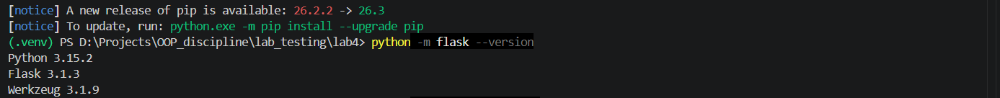
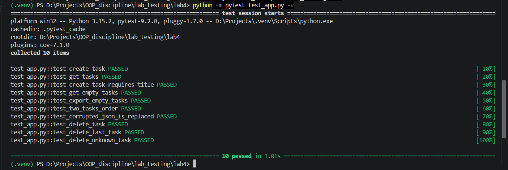
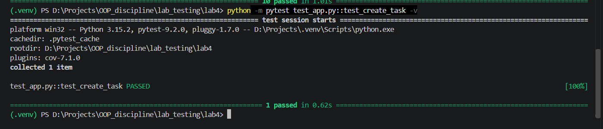
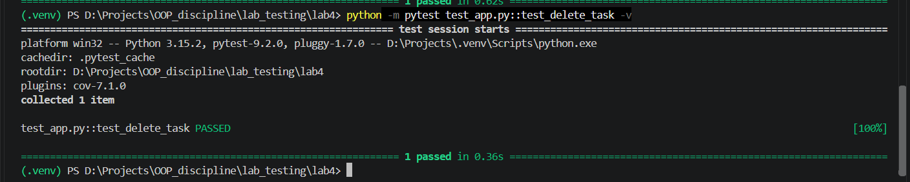
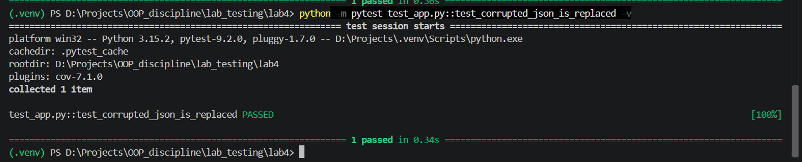

# Звіт до роботи

## Тема: Інтеграційне тестування

### Мета роботи:
Навчитися перевіряти взаємодію компонентів Flask-застосунку: вебмаршрутів, логіки обробки завдань, бази SQLite та файлової системи. Створити інтеграційні тести з використанням тимчасових ресурсів і pytest.

---

### Виконання роботи

1. **Підготовка середовища**

   Використано віртуальне середовище Python. Встановлено залежності:

   ```powershell
   python -m pip install flask pytest
   ```

   Перевірено встановлення:

   ```powershell
   python -m flask --version
   python -m pytest --version
   ```

   ![Версії інструментів]

   *Рисунок 1 — Перевірка встановлених Flask та pytest.*

2. **Підготовка застосунку**

   За основу взято вихідний код викладача. Застосунок створює таблицю tasks у SQLite, приймає запити на створення завдань і експортує дані в JSON-файл.

   Реалізовано маршрути:

   | Метод і маршрут | Призначення | Статуси |
   |---|---|---|
   | GET /tasks | Отримання списку завдань | 200 |
   | POST /tasks | Створення завдання | 201, 400 |
   | DELETE /tasks/<task_id> | Видалення завдання | 200, 404 |

   Для отримання завдань використано сортування за id:

   ```python
   rows = connection.execute(
       "SELECT id, title FROM tasks ORDER BY id"
   ).fetchall()
   ```

   У POST перевіряється, що тіло запиту є JSON-об’єктом, а title — непорожнім рядком. Після створення або видалення завдання JSON-експорт оновлюється з бази.

   Код програми: [app.py](./app.py).

   Код тестів: [test_app.py](./test_app.py).

3. **Ізоляція тестових ресурсів**

   Для кожного тесту fixture resources створює застосунок, окрему базу SQLite та шлях експорту у тимчасовій папці tmp_path:

   ```python
   @pytest.fixture
   def resources(tmp_path):
       db_path = tmp_path / "tasks.db"
       export_path = tmp_path / "tasks.json"

       app = create_app(db_path, export_path)
       app.config["TESTING"] = True

       with app.test_client() as client:
           yield client, db_path, export_path
   ```

   Робоча база користувача не використовується. Тести не залежать від даних інших тестів.

   База даних і файл експорту є справжніми, mock-об’єкти для них не застосовуються. Flask test_client обробляє запити всередині процесу без запуску мережевого сервера.

   Тимчасовими папками керує pytest. Вони можуть зберігатися певний час після запуску для діагностики та очищуються відповідно до політики зберігання pytest.

4. **Загальний запуск тестів**

   Виконано команду:

   ```powershell
   python -m pytest test_app.py -v
   ```

   Отримано:

   ```text
   collected 10 items
   10 passed in 1.01s
   ```

   ![Усі інтеграційні тести]

   *Рисунок 2 — Результат виконання інтеграційних тестів Flask-застосунку.*

5. **Створення завдання: HTTP, SQLite та JSON**

   Тест test_create_task надсилає POST-запит:

   ```python
   response = client.post(
       "/tasks",
       json={"title": "Вивчити pytest"},
   )
   ```

   Перевіряється статус і JSON-відповідь:

   ```python
   assert response.status_code == 201

   task = response.get_json()
   assert isinstance(task["id"], int)
   assert task["title"] == "Вивчити pytest"
   ```

   Після цього перевіряється фактичний запис у SQLite та вміст файла:

   ```python
   assert read_db(db_path) == [
       (task["id"], "Вивчити pytest"),
   ]
   assert read_export(export_path) == [task]
   ```

   Допоміжна функція read_db виконує SELECT безпосередньо в SQLite. Функція read_export читає файл із диска та розбирає JSON.

   Отже, тест перевіряє повний сценарій: запит → Flask-маршрут → INSERT у SQLite → експорт → HTTP-відповідь.

   Окремий запуск:

   ```powershell
   python -m pytest test_app.py::test_create_task -v
   ```

   Результат:

   ```text
   1 passed in 0.62s
   ```

   ![Тест створення завдання]

   *Рисунок 3 — Перевірка створення завдання через HTTP із записом у SQLite та JSON-файл.*

6. **Отримання списку та порядок записів**

   У test_get_tasks створюються два завдання, після чого виконується GET /tasks. Перевіряються статус 200 та відповідність списку створеним об’єктам.

   У test_two_tasks_order додатково перевіряються:

   - статус 201 обох POST-запитів;
   - зростання ідентифікаторів;
   - порядок записів безпосередньо в SQLite;
   - такий самий порядок у JSON-експорті.

   ```python
   assert first["id"] < second["id"]

   assert read_db(db_path) == [
       (first["id"], "Перше завдання"),
       (second["id"], "Друге завдання"),
   ]

   assert read_export(export_path) == [first, second]
   ```

7. **Неправильне введення та порожній список**

   У test_create_task_requires_title надсилається POST-запит без title:

   ```python
   response = client.post("/tasks", json={})

   assert response.status_code == 400
   assert response.get_json() == {
       "error": "Поле title є обов'язковим",
   }
   ```

   Також перевіряється, що база залишилася порожньою, а файл експорту не створено.

   Тест test_get_empty_tasks перевіряє GET /tasks для порожньої бази: статус 200 та відповідь [].

   Тест test_export_empty_tasks викликає export_tasks для порожньої таблиці. Файл повинен існувати й містити порожній JSON-масив:

   ```python
   export_tasks(db_path, export_path)

   assert export_path.exists()
   assert read_export(export_path) == []
   assert read_db(db_path) == []
   ```

8. **Видалення завдання**

   Додано маршрут DELETE /tasks/<int:task_id>. Він видаляє запис із бази та повторно формує експорт:

   ```python
   @app.delete("/tasks/<int:task_id>")
   def delete_task(task_id):
       with sqlite3.connect(db_path) as connection:
           cursor = connection.execute(
               "DELETE FROM tasks WHERE id = ?",
               (task_id,),
           )
           deleted = cursor.rowcount

       if deleted == 0:
           return jsonify({"error": "Завдання не знайдено"}), 404

       export_tasks(db_path, export_path)

       return jsonify({"deleted": task_id}), 200
   ```

   Тест test_delete_task створює два завдання та видаляє перше.

   Перевіряється HTTP-відповідь:

   ```python
   response = client.delete(f"/tasks/{first['id']}")

   assert response.status_code == 200
   assert response.get_json() == {"deleted": first["id"]}
   ```

   У базі та файлі має залишитися лише друге завдання:

   ```python
   assert read_db(db_path) == [
       (second["id"], "Залишити"),
   ]
   assert read_export(export_path) == [second]
   ```

   Додатково GET /tasks повинен повернути лише друге завдання.

   Окремий запуск:

   ```powershell
   python -m pytest test_app.py::test_delete_task -v
   ```

   Результат:

   ```text
   1 passed in 0.36s
   ```

   ![Тест видалення завдання]

   *Рисунок 4 — Інтеграційна перевірка видалення завдання.*

   Окремими тестами також перевірено видалення останнього завдання та спробу видалення неіснуючого запису. Після видалення останнього завдання база й експорт порожні. Для невідомого id повертається 404, а наявні дані зберігаються.

9. **Перевірка пошкодженого JSON**

   Тест test_corrupted_json_is_replaced записує некоректний JSON у файл:

   ```python
   export_path.write_text(
       '{"tasks": пошкоджений JSON',
       encoding="utf-8",
   )

   with pytest.raises(json.JSONDecodeError):
       read_export(export_path)
   ```

   Після цього надсилається POST-запит на створення завдання. Застосунок записує його в SQLite та перезаписує файл правильним JSON.

   ```python
   response = client.post(
       "/tasks",
       json={"title": "Відновлення експорту"},
   )

   assert response.status_code == 201

   task = response.get_json()

   assert read_db(db_path) == [
       (task["id"], "Відновлення експорту"),
   ]
   assert read_export(export_path) == [task]
   ```

   Джерелом даних є SQLite. Застосунок не відновлює вміст пошкодженого файла, а формує новий експорт із бази.

   Окремий запуск:

   ```powershell
   python -m pytest test_app.py::test_corrupted_json_is_replaced -v
   ```

   Результат:

   ```text
   1 passed in 0.34s
   ```

   ![Перезапис пошкодженого JSON]

   *Рисунок 5 — Перевірка перезапису пошкодженого JSON-файла даними з SQLite.*

10. **Взаємодія компонентів у тестах**

    | Тест | Компоненти та перевірки |
    |---|---|
    | test_create_task | POST, логіка створення, SQLite, JSON-файл і відповідь 201 |
    | test_get_tasks | Створення через POST, читання SQLite через GET, відповідь 200 і порядок списку |
    | test_create_task_requires_title | POST, валідація, відповідь 400, відсутність змін у базі та створення експорту |
    | test_get_empty_tasks | GET, порожня SQLite, відповідь 200 з [], відсутність експорту |
    | test_export_empty_tasks | Функція експорту, порожня SQLite, створення файла з [] |
    | test_two_tasks_order | Два POST, SQLite, перевірка id та порядку в базі й JSON |
    | test_corrupted_json_is_replaced | Файлова система, помилка розбору JSON, POST, SQLite і новий експорт |
    | test_delete_task | POST, DELETE, SQLite, JSON-файл та повторний GET |
    | test_delete_last_task | POST, DELETE, порожня база та JSON-масив після видалення |
    | test_delete_unknown_task | POST, DELETE, відповідь 404 і збереження даних SQLite та JSON |

11. **Порівняння рівнів тестування**

    | Рівень | Призначення |
    |---|---|
    | Юніт-тестування | Перевірка невеликої частини логіки ізольовано |
    | Інтеграційне тестування | Перевірка взаємодії кількох компонентів |
    | Системне тестування | Перевірка роботи системи загалом у сценаріях, близьких до використання кінцевим користувачем |

    У роботі перевіряється справжня взаємодія Flask, SQLite та файлової системи. Тести виконуються через Flask test_client, тому не перевіряють роботу зовнішнього вебсервера, мережі або браузера.

---

### Висновок

Під час роботи доповнено Flask-застосунок маршрутом видалення та створено 10 тестів взаємодії вебмаршрутів, SQLite і JSON-файлів. Усі тести завершилися успішно, мети роботи досягнуто.

Перевірено створення й отримання завдань, відсутнє поле title, порожній список, порядок записів, видалення та перезапис пошкодженого експорту. Опрацьовано всі завдання, позначені зірочками, та відмінності між юніт-, інтеграційним і системним тестуванням.

Отримано практичні знання з використання Flask test_client, fixture tmp_path, перевірки HTTP-статусів, читання SQLite та JSON. Тимчасові ресурси забезпечили незалежність тестів і збереження робочих даних користувача.

Критичних труднощів під час запуску тестів не виникло. Формат Markdown зручний для поєднання пояснень, коду та скриншотів. Для покращення роботи можна додати сценарії перевірки помилок запису файла та недоступності бази даних.

---