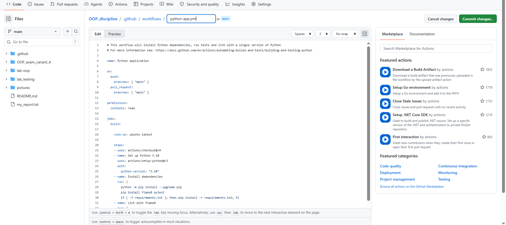
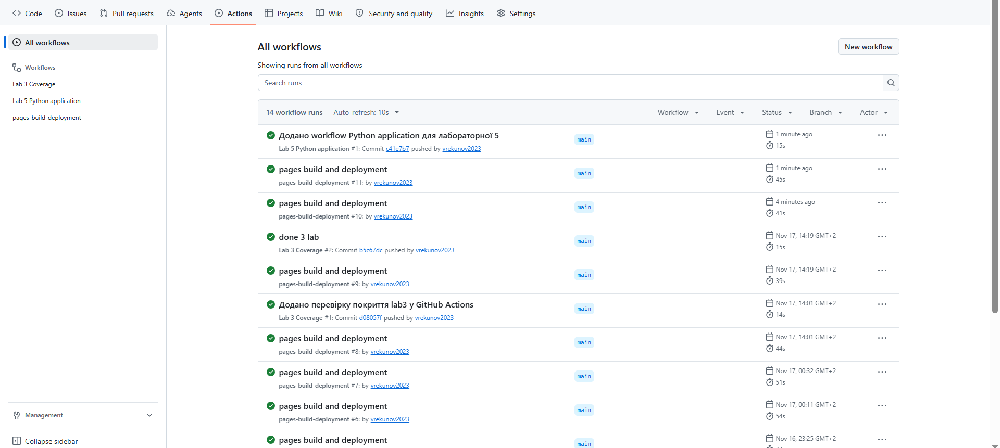
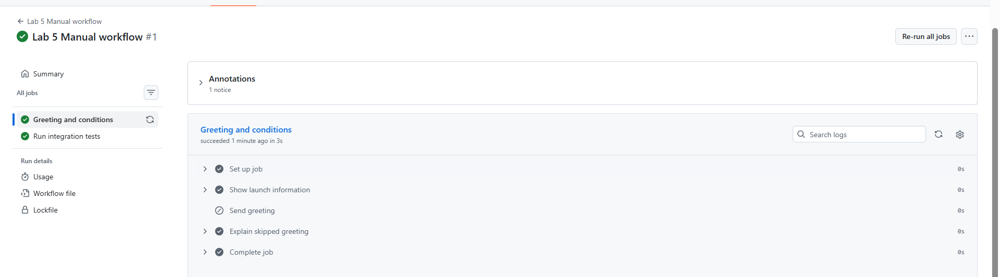
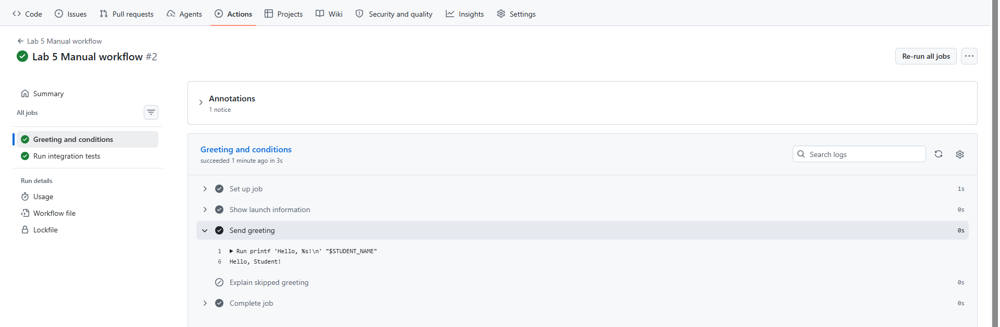
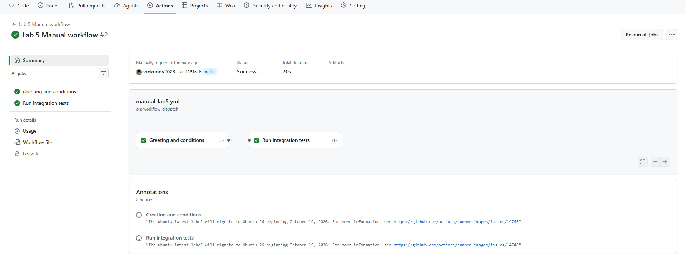
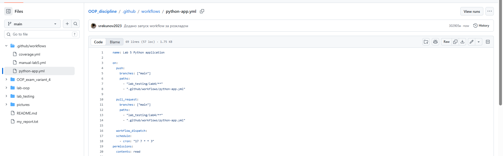
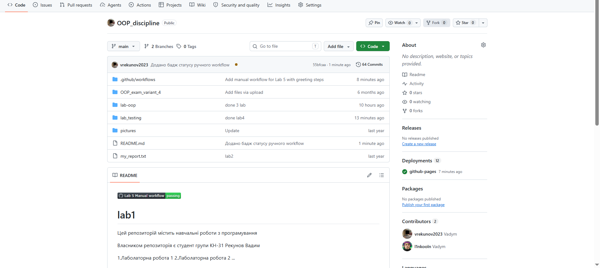

# Лабораторна робота №5
## Автоматизація за допомогою GitHub Actions

**Виконав:** Рекунов Вадим Валерійович  
**Група:** КН-41

### Мета роботи

Навчитися створювати GitHub Actions workflows, автоматично запускати Python-програму та тести, передавати параметри ручного запуску, використовувати умови, декілька завдань і розклад cron.

### 1. Створення першого workflow

У вкладці Actions обрано шаблон Python application. На його основі створено файл `.github/workflows/python-app.yml` із назвою `Lab 5 Python application`.

![Створення workflow з шаблону]

Workflow містить такі кроки:

- отримання файлів репозиторію;
- налаштування Python 3.13;
- встановлення Flask і pytest;
- перевірка синтаксису Python-файлів;
- виконання програми з лабораторної роботи №4;
- запуск інтеграційних тестів.

Залежності встановлюються командою:

```bash
python -m pip install flask pytest
```

Перевірка синтаксису:

```bash
python -m py_compile lab_testing/lab4/app.py lab_testing/lab4/test_app.py
```

Workflow запускається після push або pull request у гілку main, якщо змінено файли лабораторної №4 або сам файл workflow. Також передбачено ручний запуск через `workflow_dispatch`.

![Успішний запуск Python application]

### 2. Виконання програми та тестів

У кроці Run Python from previous laboratory використано функцію `create_app` із лабораторної роботи №4.

Програма створює Flask-застосунок із тимчасовою SQLite-базою. Через тестовий клієнт виконується GET-запит до `/tasks`. Перевіряються статус відповіді 200 та порожній список завдань.

Отримано результат:

```text
HTTP status: 200
Tasks: []
```

Далі з каталогу `lab_testing/lab4` виконано команду:

```bash
python -m pytest test_app.py -v
```

Результат у GitHub Actions:

```text
10 passed in 0.12s
```

Тести перевіряють створення, отримання та видалення завдань, відсутність обов’язкового поля title, порядок записів, порожній список і перезапис пошкодженого JSON-файла.

![Виконання програми та десяти тестів]

### 3. Ручний запуск із параметром

Створено другий файл `.github/workflows/manual-lab5.yml` із назвою `Lab 5 Manual workflow`.

Для ручного запуску налаштовано параметр `student_name`:

```yaml
on:
  workflow_dispatch:
    inputs:
      student_name:
        description: "Ім'я для привітання або Executer для пропуску"
        required: true
        default: "Executer"
        type: string
```

Параметр вводиться у формі Run workflow та передається кроку через змінну середовища `STUDENT_NAME`.

### 4. Перевірка умов виконання

Крок Send greeting виконується за умовою:

```yaml
if: inputs.student_name != 'Executer'
```

Крок Explain skipped greeting має протилежну умову:

```yaml
if: inputs.student_name == 'Executer'
```

Під час першого запуску залишено значення `Executer`. Крок Send greeting пропущено, а Explain skipped greeting виконано.

![Пропуск привітання для Executer]

Під час другого запуску передано значення `Student`. Крок Send greeting виконано, отримано повідомлення:

```text
Hello, Student!
```

Крок Explain skipped greeting у цьому запуску пропущено.

![Виконання привітання для Student]

Таким чином, перевірено обидва варіанти роботи умов.

### 5. Декілька завдань у workflow

Ручний workflow містить два завдання:

1. Greeting and conditions — обробляє параметр та виконує умовні кроки.
2. Run integration tests — встановлює залежності та запускає тести лабораторної №4.

Залежність другого завдання від першого задано так:

```yaml
needs: greeting
```

Тому тести запускаються після успішного завершення завдання greeting. Обидва завдання завершилися успішно. Загальна тривалість другого ручного запуску становила 20 секунд.

![Результат виконання двох завдань]

У репозиторії створено два окремі workflows для цієї роботи: Lab 5 Python application і Lab 5 Manual workflow.

### 6. Запуск за розкладом

До Python application додано розклад:

```yaml
on:
  # Інші тригери залишено у файлі.
  schedule:
    - cron: "17 7 * * 3"
```

Вираз cron задає запуск щосереди о 07:17 UTC. У листопаді це відповідає 09:17 за київським часом.

Поля виразу означають:

- `17` — хвилина;
- `7` — година;
- перша `*` — будь-який день місяця;
- друга `*` — будь-який місяць;
- `3` — середа.

![Налаштування розкладу]

Після збереження змін workflow успішно виконався через подію push. На момент складання звіту запуск через schedule ще не зафіксовано.

Після першого виконання за розкладом заплановано видалити секцію schedule, щоб уникнути повторних автоматичних запусків.

### 7. Бадж статусу

Через меню Create status badge отримано Markdown-код і додано на початку головного README.md:

```markdown
[](https://github.com/vrekunov2023/OOP_discipline/actions/workflows/manual-lab5.yml)
```

Бадж відображає статус passing. Натискання на нього відкриває сторінку відповідного workflow.

![Бадж у README]

### Висновок

Створено два workflows GitHub Actions. Налаштовано виконання Python-програми та інтеграційних тестів, ручний запуск із параметром, умовне виконання кроків і послідовність двох завдань.

У GitHub Actions успішно пройшли всі 10 інтеграційних тестів. Додано бадж статусу до README.md та налаштовано щотижневий розклад. Фактичне виконання за розкладом потребує окремої перевірки.

### Посилання

- [Репозиторій](https://github.com/vrekunov2023/OOP_discipline)
- [Python application](https://github.com/vrekunov2023/OOP_discipline/actions/workflows/python-app.yml)
- [Manual workflow](https://github.com/vrekunov2023/OOP_discipline/actions/workflows/manual-lab5.yml)